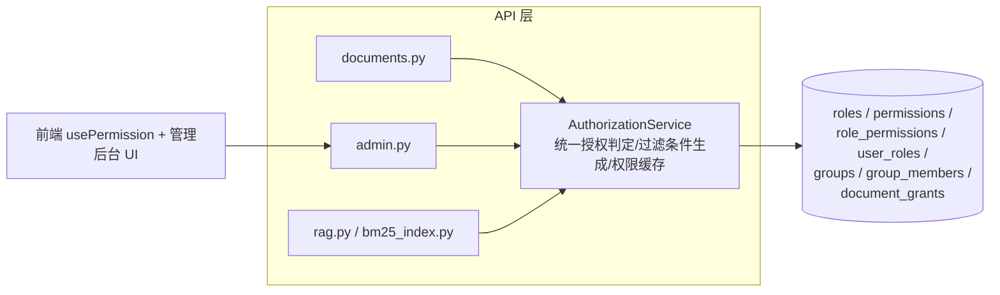

## 用户需求

为 web-agent 系统设计并实现细粒度权限控制：动态 RBAC（角色/权限点存表，admin 可在管理后台自定义角色并勾选权限）+ 文档级 ACL（引入用户组/部门概念，文档可授权给指定用户或用户组，区分 read/write，组内成员自动继承权限）。ACL 仅覆盖 Document/Chunk，会话、记忆等其他资源保持现有 owner 校验不变。

## 产品概述

在现有"user/admin 二值角色 + 文档 private/team 二值可见性"的粗粒度授权基础上，升级为可配置的权限体系：管理员可定义角色与权限点、管理用户组，文档所有者可把文档共享给个人或组并控制读写级别，RAG 检索召回结果严格按 ACL 过滤，前端按用户实际权限点动态显隐功能入口。

## 核心功能

- **动态 RBAC**：角色（roles）、权限点（permissions）、角色-权限关联、用户-角色关联均存表；内置 admin/editor/viewer 等预置角色并向后兼容现有 'user'/'admin' 数据；admin 可在管理后台增删角色、勾选权限点、给用户分配角色
- **用户组**：支持创建用户组/部门、维护组成员；组的创建与管理权限受权限点控制
- **文档级 ACL**：document_grants 授权表（grantee_type: user/group，permission: read/write）；文档所有者可对个人或组授权/撤销；read 含查看与 RAG 召回，write 含编辑/删除/再授权之外的更新操作；owner 拥有全部权限
- **统一授权层**：收敛 documents.py 的 _can_read/_can_write 与 rag.py/bm25_index.py 三处内联召回过滤到统一授权服务；向量 SQL 与 BM25 过滤改为基于 ACL 表的 join/子查询（兼容 PG 与 SQLite）；越权仍统一返回 404 不泄露存在性
- **管理后台 UI**：新增角色管理、权限点勾选、用户组管理、成员管理页面；文档页新增共享授权弹窗；前端按钮/入口按权限点显隐
- **兼容与迁移**：Alembic 新迁移（PG）+ SQLite create_all 兼容；保留"最后一名 admin"保护语义；visibility 字段保留并叠加 ACL（team 语义平滑过渡）

## 技术栈选择

完全复用现有栈，不引入新框架：

- 后端：FastAPI 0.115（异步）+ SQLAlchemy 2.0 asyncio + Pydantic v2 + Alembic
- 数据库：PostgreSQL（生产）/ SQLite（开发）双后端兼容
- 前端：React 18 + TypeScript + Vite + Tailwind + zod + react-router-dom v6

## 实现方案

### 总体策略

采用"一张授权服务收口"的思路：先建 RBAC/ACL 数据模型与迁移，再实现 `AuthorizationService` 统一判定入口，最后逐点替换现有内联授权逻辑（文档路由、RAG 召回、管理端守卫），前端补充管理界面与权限驱动渲染。

### 数据模型设计（新增表）

- `roles`：id, name(唯一), description, is_builtin（内置角色不可删）
- `permissions`：id, code(唯一, 如 `document:create`、`document:share`、`admin:user_manage`、`admin:role_manage`、`admin:group_manage`、`admin:eval`…), description；权限点目录（permission catalog）以代码常量定义并在迁移/启动时 upsert 入表，保证代码与表一致
- `role_permissions`：role_id + permission_id 联合主键
- `user_roles`：user_id + role_id 联合主键
- `groups`：id, name(唯一), description, owner_id（创建者/组管理员）
- `group_members`：group_id + user_id 联合主键
- `document_grants`：id, document_id(FK CASCADE), grantee_type('user'|'group'), grantee_id, permission('read'|'write'), granted_by, created_at；(document_id, grantee_type, grantee_id) 唯一约束，write 覆盖 read（存储一条最高权限，upsert 语义）

### 向后兼容

- 现有 `User.role`('user'/'admin') 映射为内置角色：迁移中创建 builtin admin/user 角色，admin 角色授予全部权限点，user 角色授予基础权限点；`User.role` 列保留作为快速判断/展示，权限判定以 user_roles + role_permissions 为准
- `Document.visibility` 保留：`team` 语义继续生效（等价于对全员可读），ACL 在其上叠加指定用户/组的 read/write；后续如需纯 ACL 可再下线
- `require_admin` 平滑过渡：改为 `require_permission("admin:*")` 风格的依赖工厂，内置 admin 角色持有全部权限点，行为不变；保留"最后一名 admin 保护"（撤销角色/降级时检查）
- JWT 不含角色声明的现状保持不变，权限每请求查库；为防热点查询，在 AuthorizationService 内对"用户→权限点集合"做进程内短 TTL（如 60s）缓存，角色/组成员变更时主动失效

### 统一授权服务

新增 `backend/app/services/authorization.py`：

- `get_user_permissions(user_id) -> set[str]`：经 user_roles→role_permissions 聚合，带缓存
- `can_read_document(user, doc)` / `can_write_document(user, doc)`：判定顺序：owner > 权限点（admin 级）> 显式 grant（user 直授 + 经 group_members 展开的组授权，write 蕴含 read）> visibility=='team'（仅 read）
- `visible_document_filter(user) -> SQLAlchemy 条件`：生成可复用的 SQL 过滤条件（EXISTS 子查询 document_grants 左联 group_members），供文档列表、RAG 向量 SQL（rag.py:197,:220）与 BM25 索引过滤（bm25_index.py:80,113）三处统一使用，消除内联重复
- 性能要点：召回过滤使用 EXISTS 子查询而非 Python 侧展开，复杂度 O(索引查找)；为 document_grants(document_id)、document_grants(grantee_type, grantee_id)、group_members(user_id) 建索引；Chunk 上冗余 user_id 保留不动（避免大迁移），召回过滤改走授权服务条件

### API 设计

- `admin.py` 扩展：角色 CRUD + 权限点列表 + 给用户分配角色；用户组 CRUD + 成员管理（受 `admin:group_manage` 或组 owner 控制）
- `documents.py` 新增：`GET/PUT/DELETE /documents/{id}/grants`（授权列表/授予/撤销，仅 owner 或持 `document:share` 权限者可操作）；现有读写端点切换到 can_read/can_write 判定，越权仍 404
- 依赖注入：`require_permission(code: str)` 工厂函数放在 `core/security.py`，与 get_current_user 组合

### 前端

- AuthContext 的 `/auth/me` 响应扩展返回权限点集合；提供 `usePermission(code)` hook 驱动按钮/路由显隐（替代现有 role==='admin' 硬编码判断：ChatPage.tsx:329、DocumentsPage.tsx:862、ModelSettingsPage.tsx:160）
- 管理后台新增：角色管理（角色列表 + 权限点勾选矩阵）、用户组管理（组列表 + 成员维护）；文档页新增"共享"弹窗（搜索用户/组、read/write 选择、撤销）
- `/admin` 路由增加前端守卫（持任一 admin:* 权限点可进入），后端 403 兜底不变

## 实现注意事项

- **双后端兼容**：所有新 SQL 用 SQLAlchemy 表达式编写，避免 PG 方言；迁移用 Alembic 标准 op，SQLite 模式继续走 create_all（main.py:51-57 逻辑不变）
- **回归风险控制**：documents.py 与 rag.py 的授权切换保持函数签名兼容，逐端点替换；现有越权 404 语义（不泄露存在性）必须保留
- **缓存一致性**：权限缓存按 (user_id) 键控，角色/权限/组成员写操作后统一调用 invalidate；TTL 兜底防脏读
- **日志**：授权失败不打印敏感文档内容，仅记录 user_id/doc_id/动作，DEBUG 级
- **测试**：为授权服务与各判定路径补单元测试（owner/admin/直授/组继承/write 蕴含 read/visibility 叠加/越权 404）

## 架构设计



## 目录结构

```
backend/
├── alembic/versions/
│   └── 0016_rbac_acl.py                # [NEW] RBAC+ACL 全部新表迁移；内置角色/权限点 upsert；User.role 数据迁移
├── app/
│   ├── models/
│   │   ├── rbac.py                     # [NEW] Role/Permission/RolePermission/UserRole ORM 模型，含唯一约束与索引
│   │   ├── group.py                    # [NEW] Group/GroupMember 模型
│   │   ├── document_grant.py           # [NEW] DocumentGrant 模型（grantee_type/grantee_id/permission，唯一约束）
│   │   └── __init__.py                 # [MODIFY] 导出新模型，保证 create_all 覆盖
│   ├── schemas/
│   │   └── rbac.py                     # [NEW] 角色/权限点/用户组/授权 的 Pydantic DTO（含校验）
│   ├── services/
│   │   └── authorization.py            # [NEW] 统一授权服务：权限点聚合（带缓存）、文档读写判定、可见性 SQL 条件生成
│   ├── core/
│   │   └── security.py                 # [MODIFY] 新增 require_permission(code) 依赖工厂；require_admin 改为其特例，语义不变
│   └── api/
│       ├── admin.py                    # [MODIFY] 角色 CRUD/权限点列表/用户角色分配/用户组与成员管理；VALID_ROLES 硬编码迁移为动态角色；保留最后一名 admin 保护
│       ├── admin_groups.py             # [NEW]（或并入 admin.py）用户组 CRUD 与成员管理路由
│       ├── documents.py                # [MODIFY] 切换 can_read/can_write 判定；新增 grants 授权/撤销/列表端点；保持越权 404
│       ├── auth.py                     # [MODIFY] /auth/me 响应附带权限点集合
│       └── __init__.py                 # [MODIFY] 注册新路由
└── tests/（或现有测试目录）
    └── test_authorization.py           # [NEW] 授权服务单测：全部判定路径与召回过滤条件

frontend/src/
├── auth/
│   ├── AuthContext.tsx                 # [MODIFY] 用户态携带 permissions；新增 usePermission hook
│   └── PermissionGuard.tsx             # [NEW] 路由/组件级权限守卫组件
├── api/
│   └── client.ts                       # [MODIFY] 新增角色/组/授权相关 API 封装（zod 校验）
├── pages/
│   ├── admin/RolesPage.tsx             # [NEW] 角色管理页：角色列表、权限点勾选矩阵、成员分配
│   └── admin/GroupsPage.tsx            # [NEW] 用户组管理页：组 CRUD、成员维护
├── components/
│   └── ShareDialog.tsx                 # [NEW] 文档共享弹窗：搜索用户/组、read/write 选择、撤销
├── App.tsx                             # [MODIFY] 注册新路由，/admin 加权限守卫
└── （ChatPage.tsx / DocumentsPage.tsx / ModelSettingsPage.tsx）
                                        # [MODIFY] role==='admin' 硬编码显隐改为 usePermission 驱动
```

## 设计风格

延续项目现有 Tailwind + React 的工程化风格，管理后台采用企业级 Material Design 取向：卡片式布局、清晰层级、表格化数据呈现。新组件（角色权限矩阵、用户组管理、文档共享弹窗）使用 shadcn 风格组件与现有 Tailwind 体系无缝融合。

## 页面规划（3 个新界面 + 2 处改造）

- **角色管理页（/admin/roles）**：左侧角色列表卡片（内置角色带徽标锁定），右侧权限点勾选矩阵（按模块分组：文档/用户/角色/用户组/评测），顶部操作栏（新建角色、保存、删除）；变更未保存时有脏状态提示
- **用户组管理页（/admin/groups）**：顶部搜索 + 新建组按钮；组卡片列表展示组名、成员数、创建者；点击进入成员管理抽屉（Drawer），支持搜索添加/移除成员
- **文档共享弹窗（文档页内）**：Modal 结构，顶部搜索框可检索用户与组（带类型图标区分），授权条目列表显示被授权方、权限级别下拉（可读/可写）、撤销按钮；底部展示当前已授权清单
- **改造：管理后台导航**新增"角色权限""用户组"入口，按 admin:* 权限点显隐
- **改造：文档列表行操作**新增"共享"按钮（仅 owner 或持 document:share 权限可见）

## 交互细节

- 权限矩阵勾选即时高亮，hover 行/列交叉高亮便于定位
- 共享弹窗搜索防抖 300ms，结果分组展示（用户/用户组）
- 危险操作（删除角色、撤销授权、移除成员）二次确认
- 空状态使用插画占位 + 引导按钮
- 响应式：管理页桌面优先，最小适配 1280px；共享弹窗自适应宽度

## Agent Extensions

### SubAgent

- **code-explorer**
- Purpose: 实施前对授权改造点（documents.py、rag.py、bm25_index.py、admin.py）做精确调用链确认，确保替换点无遗漏
- Expected outcome: 输出准确的替换点清单与函数签名，保证重构不破坏现有行为

### Skill

- **ui-ux-pro-max**
- Purpose: 为角色权限矩阵、用户组管理、文档共享弹窗三个新界面提供设计规范与交互细节参考
- Expected outcome: 管理后台 UI 风格统一、交互符合可用性规范