## 用户需求

将改进杠杆 1（自适应 k，选定 L4 Router 方向）以"仅实验验证 + 报告"方式落地：对 iter10（L4 Router）出现的 MRR -3.2pt 损失做逐题归因，通过评估侧 monkey-patch 实验调优 Router 的 top_k 映射，验证能否在保持精准率优势（35.6%，全场最优）的同时收窄 MRR 损失，最终输出 L4 Router 启用建议报告。改进杠杆 2（rerank + 断崖截断）因本地 reranker 加载失败（bad allocation）跳过修复，作为留待事项写入报告。

## 产品概述

ragbench v2 评估体系已建立（50 题 × 7 指标，基线 + 12 轮单变量迭代 + 组合验证全部完成）。本轮在既有框架内做 L4 Router 的深度归因与映射调优，不改任何线上代码与配置（backend/app/、.env、profiles 均不动），所有实验变量通过评估侧注入。

## 核心功能

- **MRR 损失归因**：逐题对比 baseline 与 iter10 的明细，定位 MRR -3.2pt 来自哪些题目、对应 Router 分类与 top_k 映射档位，并验证"RRF 融合池随 candidate_k 变化导致排名偏移"的机制假设（rerank 关闭时 candidate_k = top_k，factual→3 缩小融合池）
- **Router 映射调优变量**：ragbench 新增 router top_k 映射的 monkey-patch 能力（参照既有 rrf_k 先例），同时修复 route() 结果缓存跨实验污染问题（apply_config 中重置 router 缓存）
- **调优实验**：factual 映射 3→4、3→5 两组单变量实验（L4 + 全量 50 题生成层评审），量化 MRR/精准率权衡曲线，选定最优映射
- **启用建议报告**：含归因结论、调优实验数据、启用成本（每查询 +1 次 LLM 调用）、原生回退机制（L4 失败回退 L2）、留待事项（reranker 修复 / 断崖截断验证 / overlap128 / 组合复测），并同步更新评估总结报告

## 技术栈

- 沿用 ragbench v2 全部设施：Python 3.11+ / SQLite + fastembed 离线建库 / DeepSeek（生成 + judge）/ openpyxl
- 实验变量注入：env + get_settings.cache_clear()（既有）+ monkey-patch（既有 rrf_k 先例，本轮扩展 router 映射）
- 运行环境：conda langgraph（C:/Users/gys3894/.conda/envs/langgraph/python.exe），backend/ 下 `python -m eval.ragbench.experiments`，$env:PYTHONIOENCODING='utf-8'

## 实现方案

### 总体策略

先归因、再调优：用只读分析脚本定位 iter10 MRR 损失的确切题目与机制，避免盲目调参；随后在评估侧以 monkey-patch 方式注入 Router top_k 映射变体（不碰 `backend/app/services/agents/router.py` 本体），跑 3→4 / 3→5 两组 factual 档位实验，用 7 项指标全量数据选定建议映射。

### 关键决策

- **归因先行**：iter10 召回率保持 100% 但 MRR 降 3.2pt，说明无漏命中、仅首命中排名后移。机制假设：rerank 关闭时 `candidate_k = top_k`（rag.py:312），factual→3 使向量/关键词两路召回池从 5 缩到 3，RRF 融合序改变导致 gold 块排名后移。归因脚本需逐题验证并分类（融合池偏移 / 分类错误 / 其他）
- **monkey-patch 映射而非改代码**：`_CATEGORY_TOP_K` 硬编码于 router.py:46-51，无 Settings 字段。在 `apply_config` 中按 ExperimentConfig 新字段补丁该 dict 并在退出时恢复，与 rrf_k 注入同一先例，保证评估间隔离、线上代码零改动
- **缓存污染修复**：`router.route()` 有 (session_id, query) 进程内缓存（TTL 5 分钟），同进程连跑多组实验时旧档位决策会泄漏到新实验。在 `apply_config.__enter__` 中调用既有的 `router.reset_cache()`（与 reranker/bm25 单例重置并列），这是正确性必需项
- **ExperimentConfig 新增字段**：`router_factual/router_list/router_comparison/router_summary: int | None = None`，CLI `--set` 的类型推断与字段校验自动生效（`_parse_set` 基于 `__dataclass_fields__`），无需改 CLI；实验经 `--custom router-f4 --set top_k_mode=router --set router_factual=4` 触发，不污染 EXPERIMENTS 内置矩阵
- **生成层全量评审**：映射变化改变 top_k → 改变上下文 → 每轮 50 题全量跑生成+judge（约 300 次 LLM 调用/轮），两轮约 10 分钟

### 性能与成本

- 归因分析：纯本地 JSON 读取，秒级
- 调优实验：2 轮 ×（50 题检索 + 50 题生成与评审）≈ 每轮 3~4 分钟；KB 复用（切分参数同基线，无需重建）
- route() LLM 调用：每轮 50 次分类（进程内缓存去重）

## 架构

```mermaid
flowchart LR
    A[baseline items.jsonl] --> C[attribution.py 逐题对比]
    B[iter10 items.jsonl] --> C
    C --> D[归因结论<br>题目×分类×机制]
    E[ExperimentConfig<br>+router_* 映射字段] --> F[apply_config<br>patch _CATEGORY_TOP_K<br>+ reset_cache]
    F --> G[iter13-router-f4<br>iter14-router-f5]
    G --> H[L4 Router 启用建议报告<br>+ 总结报告更新]
    D --> H
```



## 目录结构

```
backend/eval/ragbench/
├── attribution.py       # [NEW] MRR 归因分析：读取两个 run 的 items.jsonl 逐题对比
│                        #   （first_rank 变化、top_k_src 中的 router 分类、k 值、gold 命中），
│                        #   按 融合池偏移/分类错误/其他 分类汇总，输出 Markdown 归因表到
│                        #   results/attribution_router.md 并打印结论
├── config.py            # [MODIFY] ExperimentConfig 新增 router_factual/router_list/
│                        #   router_comparison/router_summary 四个 int|None 字段；
│                        #   apply_config.__enter__ 增加：按非 None 字段 patch
│                        #   router._CATEGORY_TOP_K（保存原 dict 引用并复制修改）+
│                        #   router.reset_cache()；__exit__ 恢复原映射
└── make_summary_xlsx.py # [MODIFY] TAGS 追加 iter13-router-f4、iter14-router-f5
docs/evidence/
├── rag-v2-router-启用建议.md      # [NEW] 归因结论 + 调优实验数据 + 启用建议
│                                  #   （成本/回退机制/留待事项）
└── rag-v2-评估总结报告.md         # [MODIFY] 更新 L4 Router 结论与留待清单
```

## 实施要点

- 归因脚本只读，不写任何结果文件以外的内容；先跑归因再定调优档位（若归因显示损失集中在 comparison/summary 档位而非 factual，则调优目标相应调整，plan 中 factual 3→4/3→5 为默认假设）
- patch 映射时必须复制 dict 再改（`dict(_CATEGORY_TOP_K)` 后逐项覆盖并整体替换模块属性），退出时恢复原模块属性，避免跨实验残留
- iter13/14 跑完后需重新生成汇总 xlsx（make_summary_xlsx）；若文件被 Excel 占用则提示用户关闭后重跑
- 断点续跑语义：新 tag 无历史结果，直接全量跑；同 tag 重跑需 --force
- 约束红线：不改 backend/app/ 任何文件、不改 .env/profiles、不做 reranker 缓存删除（用户已选择跳过）