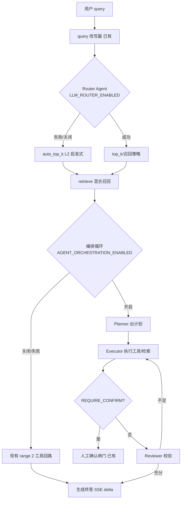

## 用户需求

为 web-agent 项目实施功能规划 P3 中的「多 Agent 编排」（docs/功能规划.md:75：检索/总结/校对分工，或工具路由 Agent）。认可的路径：先收敛非流式 LLM client → auto_top_k 升级为 LLM 路由（规划中预留的 L4 位）→ chat.py 工具回路改造为 planner-executor-reviewer 编排循环。

## 产品概述

当前对话是"单 Agent + 固定流水线"：SSE 主链路上串着 query 改写、规则路由、两轮工具调用等固定节点。本需求将其升级为轻量多 Agent 编排：查询先经 Router Agent 分类并路由到合适的检索策略；回答过程由 Planner 拆解步骤、Executor 执行工具/检索、Reviewer 校验答案充分性并决定是否继续，前端以步骤时间线展示编排过程。全部能力可开关、可降级，不影响现有用户体验。

## 核心功能

- **统一非流式 LLM client**：收敛 memory.py 与 query_rewrite.py 各自裸写的 httpx 调用为公共封装，支撑后续所有 Agent 角色（超时/重试/JSON 结构化输出/计费/tracing 统一）
- **Router Agent（L4 查询分类路由）**：小模型把 query 分类（factual/list/comparison/summary）映射召回策略与 top_k；失败自动回退现有 L2 启发式规则
- **Planner-Executor-Reviewer 编排循环**：工具回路从硬编码 2 轮升级为自主多步（Planner 出计划、Executor 执行、Reviewer 校验），最大步数/单步超时/token 预算硬限制防失控；delete_document 等危险操作仍走人工确认闸门
- **步骤时间线**：SSE 新增 agent_step 事件，前端在消息中展示编排步骤（路由决策、计划、工具执行、校验结论）
- **降级与开关**：每个 Agent 节点独立 settings 开关，关闭或失败时行为与现状完全一致
- **评测先行**：Router/Planner 上线前用现有评测中心对比前后指标

## 技术栈选择

完全复用现有栈，不引入任何新框架/中间件（遵循规划"无新组件优先"原则，不引入 LangGraph 等）：

- 后端：FastAPI + SQLAlchemy 2.0 asyncio + httpx + Pydantic v2，自研轻量编排循环
- LLM 调用：统一走 ProviderConfig（model_configs.py:18-28），复用 openai_compatible.py 的协议与计费模式
- 前端：React + TypeScript + zod（ChatEventSchema 可辨识联合扩展）
- 评测：复用 admin_eval + eval_runner 现有评测中心

## 实现方案

### 总体策略

三层递进：先打地基（统一非流式 LLM client），再做单点智能（Router Agent 替换启发式路由），最后做编排（Planner-Executor-Reviewer 循环）。每层独立 feature flag、独立降级路径，任一层关闭时系统行为与现状完全一致。

### 第一层：统一非流式 LLM client

新增 `backend/app/services/llm_client.py`：基于 ProviderConfig 的非流式 chat 调用，支持 `response_format` JSON 结构化输出（Pydantic 模型校验）、超时、单次重试、usage 回调（计费）与 Langfuse 埋点；迁移 `memory.py:_chat`（:54）与 `query_rewrite.py:rewrite_query`（:72-98）两份裸写 httpx 到该 client，行为不变。

### 第二层：Agent 底座

新增 `backend/app/services/agents/` 包：

- `roles.py`：Agent 角色协议——每个角色 = name + system prompt 构建器 + 输入/输出 Pydantic schema + 调 llm_client 的执行函数
- `context.py`：`AgentContext` 共享状态（user、session、query、召回结果、已执行步骤列表、token 预算消耗）
- `steps.py`：`AgentStep` 步骤记录（step_type/agent/摘要/耗时/token），贯穿 SSE 事件与落库留痕（复用 messages.tool_call JSON 字段，无需改表）

### 第三层：Router Agent（L4）

- `agents/router.py`：用小模型（同一 ProviderConfig，低成本分类提示词）把 query 分类为 factual/list/comparison/summary，映射到 top_k 与召回策略（是否走 broad 召回）
- 接入点唯一：`chat.py:212` 的 `auto_top_k` 调用处——`LLM_ROUTER_ENABLED=true` 时先走 Router Agent，超时/解析失败/开关关闭均回退现有 L2 启发式（rag.py:281）
- 遵循规划"边际收益需评测验证"（功能规划.md:364）：上线前用 eval_runner 对比 Router 开/关的召回指标

### 第四层：Planner-Executor-Reviewer 循环

改造 `chat.py:262-353` 的 `for round_no in range(2)` 硬编码回路为编排循环（`agents/orchestrator.py`）：

- **Planner**：基于 query + 召回摘要产出步骤计划（最多 3 步，步骤类型：retrieve/tool/answer，见定案 B4）
- **Executor**：逐步执行——工具调用复用 `tools.py` 的 TOOL_DEFINITIONS/execute_tool；`REQUIRE_CONFIRM` 闸门语义见定案 A2
- **Reviewer**：校验当前证据是否足以回答（充分→生成终答；不足→补充检索/工具一轮）
- **硬限制**：`AGENT_MAX_STEPS`（默认 4，计计划步骤数）、单步超时、`AGENT_TOKEN_BUDGET`（默认 8000，仅计 Agent 节点开销，不含终答）；超限/异常即中断编排，用已收集证据直接生成终答
- **降级**：`AGENT_ORCHESTRATION_ENABLED=false` 或 Planner 首轮失败 → 完全走现有 range(2) 行为
- 计费：每个 Agent 节点的 usage 都经 `cost.accumulate_usage` 累计（与 chat.py:278-304 一致）

#### 定案 B4：Planner 只产出意图序列，不生成工具参数

计划步骤 schema 为：

```python
class PlanStep(BaseModel):
    type: Literal["retrieve", "tool", "answer"]
    intent: str          # 自然语言意图，如"列出知识库文档确认删除目标"
    # 注意：不含工具参数
```

**理由（机制约束）**：Planner 产出计划时任何工具都尚未执行，`document_id` 等参数在计划时刻不存在——意图先于参数，二者无法同轮生成，这是死结而非调优问题。且模型经原生 `tools` 通道生成参数的可靠性（`stream_chat` 的 `delta.tool_calls` 结构化累积，`openai_compatible.py:78-79,120-128`）显著高于 JSON schema 手写生成 UUID。

**Executor 执行语义**：

- `retrieve` 步骤：调用 `rag.retrieve`（补充检索），新 chunks 过 `injection.scan_chunks` 检测后并入证据集
- `tool` 步骤：以"原始 query + 当前证据 + 该步骤 intent"构造 messages，走 `stream_chat(provider, messages, tools=TOOL_DEFINITIONS)` 由模型原生生成工具名与参数；只读工具直接 `execute_tool`；命中 `REQUIRE_CONFIRM` 走确认闸门（见定案 A2）。AgentStep 留痕记录**实际执行**的工具而非计划中的工具
- `answer` 步骤：即终答生成（流式 SSE delta）

**步数口径**：`AGENT_MAX_STEPS` 计计划步骤数；LLM 调用次数独立上限（Planner+Reviewer 各 1 + 每步骤 ≤1 次原生调用 + 终答 1），`AGENT_TOKEN_BUDGET` 为最终硬顶。

#### 定案 A2：确认闸门语义——确认后终止本轮编排，计划不跨请求持久化

编排循环中 Executor 命中 `REQUIRE_CONFIRM` 工具时：

1. 已执行步骤的 `AgentStep` 留痕落库（`messages.tool_call`，带 `kind: "agent_steps"` 判别键）；
2. assistant 消息置 `pending_confirm`，携带待确认 `tool_call`（与 `chat.py:318-331` 现状结构一致），SSE 发 `tool_call` + `done` 事件，编排循环**终止**；
3. 用户确认走现有 `POST /tools/confirm`（`api/tools.py:22-67`），执行工具、落 role=tool 消息，**本轮编排不恢复、计划剩余步骤不续跑**；
4. 用户下一轮追问时，工具执行结果已在消息历史中，新一轮编排自然感知该结果并重新规划。

**理由**：`/tools/confirm` 是独立请求，到达时本轮 SSE 连接与 `AgentContext` 已销毁；跨请求持久化编排状态（序列化计划、恢复断点）需要引入新的存储与恢复协议，复杂度远超收益。且"确认后继续原计划"并非必要体验——删除类操作天然是任务终点，现状语义（确认即结束）用户已经习惯。

**对设计的简化**：`OrchestrationResult` 无需持久化/恢复机制，其 pending_confirm 分流信号仅用于"携带已执行步骤留痕 + 终止循环"，与旧回路行为对外完全等价。

### SSE 与前端

- 新增 `agent_step` SSE 事件（type/step/label/status/duration_ms），插入在 citation 之后、delta 之前
- `api/schemas.ts` 的 ChatEventSchema 可辨识联合加 AgentStepEventSchema；`parseChatEvent` 自动覆盖
- `MessageItem.tsx`：消息头部渲染可折叠步骤时间线（路由分类、计划步骤、工具执行、Reviewer 结论），沿用现有引用面板样式
- ChatPage SSE 消费处收集 agent_step 事件挂到消息上

### 性能与可靠性

- Router/Planner/Reviewer 均为一次非流式调用（各 +1 RTT，约 300-800ms），Router 结果可按 (session_id, query_hash) 短 TTL 缓存避免追问重复分类
- 编排循环严格上限：总新增 LLM 调用 ≤ AGENT_MAX_STEPS+2 次，token 预算硬顶防失控
- 所有 Agent 节点失败都是"降级"而非"报错"：单点故障不影响主链路可用性
- 评测先行：Router 与编排各自跑 eval_runner 对比（命中率/答案分），指标不回退才默认开启；默认配置保持关闭（opt-in）

## 实现注意事项

- 复用 `rewrite_query` 的"主链路串行插入独立 LLM 角色"三件套模式（降级/计费/tracing），每个新节点照此实现
- SSE 事件顺序契约（chat.py:1-9 注释）需更新：citation *-> agent_step* -> delta* -> ...
- 步骤留痕复用 messages.tool_call JSON 字段，不改 messages 表结构
- 权限：无需新权限点；如需"谁可用编排"可在 core/permissions.py 扩展（本期不做）
- 日志：Agent 节点记录 INFO 级决策摘要（分类结果/计划步骤数/Reviewer 结论），不记录文档内容；Langfuse trace 挂到现有会话 trace 下作子 span
- 不改 worker；本期编排全部同步在 chat 请求内完成（异步子 Agent 执行器留作后续演进）

## 架构设计



## 目录结构

```
backend/
├── app/
│   ├── config.py                        # [MODIFY] 新增 llm_router_enabled / agent_orchestration_enabled / agent_max_steps / agent_token_budget / agent_step_timeout 配置
│   ├── services/
│   │   ├── llm_client.py                # [NEW] 统一非流式 LLM client：JSON 结构化输出（Pydantic 校验）、超时/重试、usage 计费回调、Langfuse 埋点；所有 Agent 角色唯一调用入口
│   │   ├── memory.py                    # [MODIFY] _chat 迁移到 llm_client（行为不变）
│   │   ├── query_rewrite.py             # [MODIFY] 裸写 httpx 迁移到 llm_client（行为不变）
│   │   ├── rag.py                       # [MODIFY] auto_top_k 增加 Router 结果入口（签名兼容，L2 保留为降级）
│   │   └── agents/
│   │       ├── __init__.py              # [NEW] 包导出
│   │       ├── context.py               # [NEW] AgentContext：user/session/query/召回结果/步骤列表/token 预算的共享状态
│   │       ├── steps.py                 # [NEW] AgentStep 步骤记录与 SSE 事件序列化
│   │       ├── router.py                # [NEW] Router Agent：query 分类 factual/list/comparison/summary → top_k 映射；超时/解析失败抛 RouterFallback 由调用方降级 L2
│   │       ├── planner.py               # [NEW] Planner/Reviewer 角色：计划生成（≤3 步）与答案充分性校验，JSON schema 强校验
│   │       └── orchestrator.py          # [NEW] 编排循环：Planner→Executor→Reviewer，步数/超时/token 硬限制，REQUIRE_CONFIRM 闸门复用，异常中断用已有证据直接终答
│   └── api/
│       └── chat.py                      # [MODIFY] 工具回路改造：开关关闭走现有逻辑；开启走 orchestrator；发 agent_step 事件；事件顺序契约注释更新
└── tests/
    ├── test_llm_client.py               # [NEW] JSON 解析/重试/超时/计费回调
    └── test_agents.py                   # [NEW] Router 分类映射与降级、编排循环步数上限/token 预算/Reviewer 终止/确认闸门

frontend/src/
├── api/schemas.ts                       # [MODIFY] ChatEventSchema 联合新增 AgentStepEventSchema（type: "agent_step"）
├── components/
│   ├── AgentStepTimeline.tsx            # [NEW] 可折叠步骤时间线：路由分类/计划/工具执行/校验结论，沿用引用面板样式
│   └── MessageItem.tsx                  # [MODIFY] 消息头部挂载步骤时间线
└── pages/ChatPage.tsx                   # [MODIFY] SSE 消费收集 agent_step 事件挂到消息
```

## Key Code Structures

```python
# services/agents/steps.py — 步骤记录（SSE agent_step 事件与留痕共用）
class AgentStep(BaseModel):
    step_type: Literal["router", "plan", "tool", "review"]
    agent: str            # 角色名：router/planner/executor/reviewer
    label: str            # 一句话摘要（前端时间线展示）
    status: Literal["running", "done", "failed", "skipped"]
    duration_ms: int = 0
    detail: dict = {}     # 分类结果/计划内容/工具名等

# services/agents/router.py — Router 输出 schema
class RouteDecision(BaseModel):
    category: Literal["factual", "list", "comparison", "summary"]
    top_k: int            # 映射规则：factual→3, list/comparison→10, summary→8
    reason: str = ""

# services/agents/planner.py — Planner 输出 schema（定案 B4：只出意图，参数走原生 tools 通道）
class PlanStep(BaseModel):
    type: Literal["retrieve", "tool", "answer"]
    intent: str           # 自然语言意图，不含工具参数

class Plan(BaseModel):
    steps: list[PlanStep]  # ≤3 步

# services/agents/orchestrator.py — 编排入口（chat.py 唯一调用点）
async def run_orchestrated(
    db, ctx: AgentContext, provider: ProviderConfig,
    on_step: Callable[[AgentStep], Awaitable[None]],  # SSE 回调
) -> OrchestrationResult:  # 含终答 messages 追加序列 / pending_confirm 分流信号
    ...
```

## Agent Extensions

### SubAgent

- **code-explorer**
- Purpose: 实施编排循环改造前，对 chat.py 工具回路、tools.py 确认链路、rerank/retrieve 调用点做精确调用链确认，确保改造点无遗漏
- Expected outcome: 输出准确替换点清单，保证编排改造不破坏 SSE 事件顺序契约与确认闸门语义