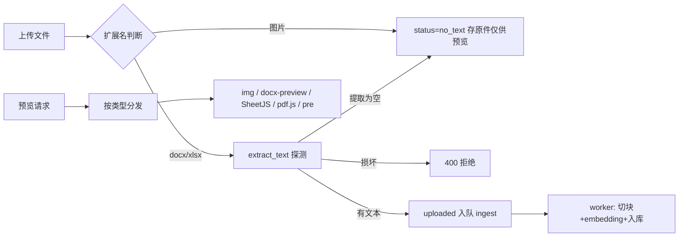

## Product Overview

为企业内部知识库（web-agent）增加多模态文档能力：支持上传图片与 Office 文档，并优化文档预览体验，按文件类型自动适配最合适的预览方式。

## Core Features

- 新增图片上传（png/jpg/jpeg/webp）：仅保存原件供预览，不做 OCR，不可 RAG 检索（复用现有 no_text 终态）
- 新增 docx/xlsx 上传：后端 python-docx/openpyxl 提取文本（段落+表格逐行拼接），走现有切块入库流程，RAG 可检索
- 预览按类型分发：
- 图片 → 原图 `` 预览（blob URL，带鉴权）
- docx → docx-preview 保留排版的文档视图
- xlsx → SheetJS 渲染表格 + sheet 切换
- pdf → 保留现有 pdf.js canvas 逐页渲染
- txt/md → 保留现有文本视图
- 上传白名单、accept、提示文案、文件类型图标同步扩展；损坏的 docx/xlsx 在请求内 400 拒绝；提取后无文本（如纯图 docx/空表）进入 no_text

## Tech Stack Selection

- 后端（复用现有栈）：FastAPI + SQLAlchemy async + pypdf；新增 `python-docx~=1.1.0`（docx 提取）、`openpyxl~=3.1.0`（xlsx 提取），均为懒加载纯 Python 轻依赖
- 前端（复用现有栈）：React + TypeScript + Tailwind + pdfjs-dist（现有）；新增 `docx-preview`（docx 渲染）、`xlsx`（SheetJS 表格渲染），均动态 import 懒加载
- 无数据库字段变更、无 alembic 迁移、无新表

## Implementation Approach

后端以 `extract_text()` 为唯一扩展点（worker 与 API 探测共用），新增 docx/xlsx 分支；图片走独立分支直接置 no_text，不触碰文本提取。前端重构 `DocumentPreviewModal` 为按扩展名分发渲染器，新增 image/docx/xlsx 三个渲染分支，pdf/text 分支保留不动。所有预览数据仍经 `getFileBytes()`（带 Bearer/Cookie 鉴权）取回字节，图片转 blob URL、docx/xlsx 喂给前端库，避免 img src 直链跨域丢 Cookie。

## Implementation Notes

- docx/xlsx 依赖必须懒加载（与 pypdf 一致），不拖慢 API 进程启动
- xlsx 用 `load_workbook(read_only=True, data_only=True)`，迭代完 `wb.close()`
- docx 提取需含表格单元格（逐行 tab 拼接）；xlsx 提取每 sheet 以 `## Sheet: {name}` 分隔保留表格语义
- 图片 blob URL 在卸载/换文档时 `revokeObjectURL`，防内存泄漏
- docx-preview 与 SheetJS 动态 import，不增大主 bundle
- docx-preview 需注入基础样式（容器类名包裹），避免覆盖应用主题
- 上传/内容更新两个端点的白名单、探测分支保持同步；`reingest` 对 no_text 的 `NOT_INGESTABLE` 文案扩义为「图片/无文字层文档不可切分」

## Architecture Design



## Directory Structure

```
backend/
├── requirements.txt                      # [MODIFY] 新增 python-docx、openpyxl（带使用位置注释）
├── app/
│   ├── services/
│   │   └── chunking.py                   # [MODIFY] extract_text 新增 .docx（段落+表格）与 .xlsx（逐 sheet 逐行）分支，均懒加载；docstring 更新支持清单
│   ├── api/
│   │   └── documents.py                  # [MODIFY] 模块级 ALLOWED_EXTENSIONS/IMAGE_EXTENSIONS 常量；upload_document 与 update_document_content：图片分支直接 no_text、docx/xlsx 复用 PDF 探测模式（异常 400/空文本 no_text）；_media_type 补 5 种 MIME；reingest 文案扩义
│   └── models/
│       └── document.py                   # [MODIFY] no_text 状态注释扩义为「图片或无文字层 PDF」
frontend/
├── package.json                          # [MODIFY] 新增 docx-preview、xlsx 依赖
└── src/
    ├── components/
    │   └── DocumentPreviewModal.tsx      # [MODIFY] 重构：文件类型工具函数分发 image/docx/xlsx/pdf/text 五种渲染器；image 用 blob URL（卸载 revoke）；docx 用 renderAsync 到容器；xlsx 用 XLSX.read + sheet 切换 tab + 表格渲染；pdf/text 分支不动；头部加类型徽标
    └── pages/
        └── DocumentsPage.tsx             # [MODIFY] 上传 accept 扩展、「仅支持 .txt/.md/.pdf」文案同步；列表图标按类型区分（Image/FileSpreadsheet/FileText）
```

## Key Code Structures

```python
# backend/app/api/documents.py 模块级常量（示意）
ALLOWED_EXTENSIONS = (".txt", ".md", ".markdown", ".pdf",
                      ".png", ".jpg", ".jpeg", ".webp", ".docx", ".xlsx")
IMAGE_EXTENSIONS = (".png", ".jpg", ".jpeg", ".webp")
```

```typescript
// frontend/src/components/DocumentPreviewModal.tsx 类型分发（示意签名）
type DocKind = "pdf" | "text" | "image" | "docx" | "xlsx";
function docKind(filename: string): DocKind;
```

## Design Content

预览弹窗在现有白底卡片布局上扩展五种视图，保持交互一致性：

- 弹窗头部：文件图标按类型替换（图片 Image 绿色 / 表格 FileSpreadsheet 蓝色 / 文档 FileText 灰色）+ 文件名 + 关闭按钮，新增类型小徽标
- 图片视图：深灰 slate-100 底居中展示原图，max-h 限制 + 点击放大（overflow-auto 可滚动查看大图），支持缩放光标提示
- docx 视图：docx-preview 渲染白纸卡片（居中、阴影、限宽约 760px，与 pdf canvas 视觉一致），可滚动翻阅
- xlsx 视图：底部工具栏位置改为 sheet 名切换 tab（复用现有分页条样式区域），主体为带主题色的 HTML 表格：表头行加粗浅底、单元格边框细线、等宽字体对齐数字，超宽表格横向滚动
- pdf/text 视图：完全保留现有样式与翻页条不动
所有视图共用 loading/error 状态样式，错误提示红色块沿用现有规范